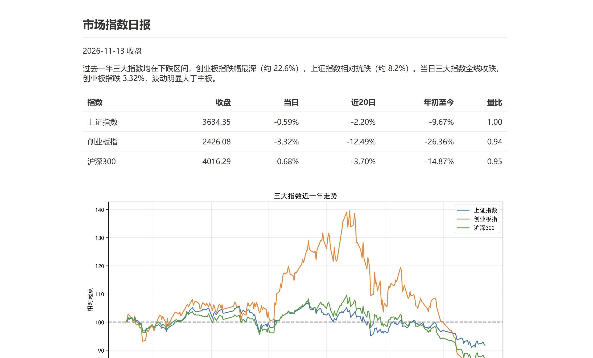

# 市场指数日报



每个交易日收盘后自动更新上证指数、沪深300、创业板指的数据，生成一个静态网页。

## 页面能看到什么

- 三个指数的收盘价、当日 / 近 20 日 / 年初至今涨跌幅、量比
- 近一年归一化走势对比（起点 = 100）
- 当日涨跌幅柱状图

## 怎么跑

```bash
pip install -r requirements.txt

python fetch.py     # 抓数据到 data/raw/
python report.py    # 算指标到 output/metrics.csv
python charts.py    # 出图到 docs/img/
python page.py      # 生成网页 docs/index.html
```

然后浏览器打开 `docs/index.html`。

## 数据来源

新浪财经（通过 akshare 获取）。每个交易日收盘后由 GitHub Actions 自动更新。

## 技术栈

Python · pandas · matplotlib · akshare · GitHub Actions

## 下一步（暂不实现）

- 增加更多指数
- 交互式图表
- 邮件 / 微信推送

## 复盘
通过这次小项目，我在爬取数据时最开始直接把akshare放在py文件开头，导致频繁 调试IP短暂被冻结，后来咨询AI后，换了一种策略，将其封装在函数中，并设置备用接口。

在清洗数据并算出涨幅比时，没有设置好保留小数点的位数，导致数据冗余，影响外观，后来统一保留两位小数。最开始用两个py文件来绘制图表，导致每次都读取数据，不便管理，于是将绘制指数趋势的图表、当日涨幅比柱状图的脚本合并为一个文件。

在绘制指数走势的图表时，最开始没有设置好x轴的刻度，导致250个数据全部堆叠在了一起，所以运用set_major_locator()的方法，以两个月为一个刻度。

目前report、charts代码还不够简洁，后期还需优化改善。比如在进行数据清洗的时候，代码冗余，没有进行较好的封装。保存涨幅比的表格时，将指数名称、收盘数硬编码在字典中，容易导致数据错位。